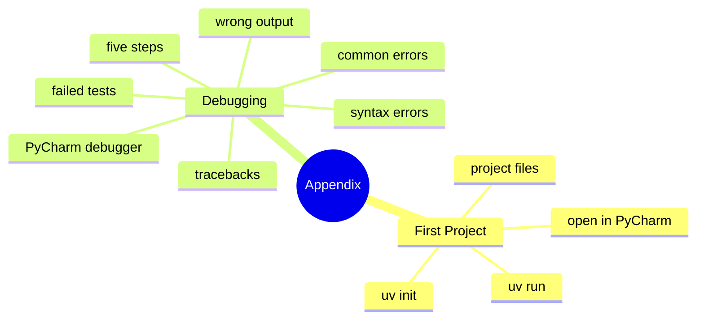

# Table of Contents

## Recommended Reading Order

1. [`first_project.md`](first_project.md) - Start a Python project of your own, outside the workbook
2. [`debugging.md`](debugging.md) - Read error messages, find bugs, and step through a program in PyCharm
