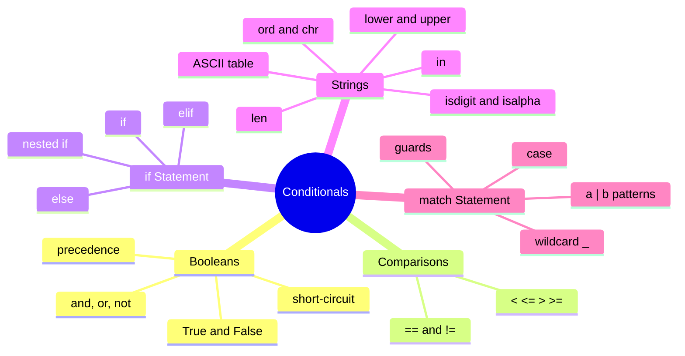

# Table of Contents

## Recommended Reading Order

1. [`boolean_operators.md`](boolean_operators.md)
2. [`comparison_operators.md`](comparison_operators.md)
3. [`if_elif_else.md`](if_elif_else.md)
4. [`string_utils.md`](string_utils.md)
5. [`ascii_table.md`](ascii_table.md)
6. [`match.md`](match.md)

## Practice Questions

1. [`can_vote`](../can_vote/can_vote.md)
2. [`even_odd`](../even_odd/even_odd.md)
3. [`number_sign`](../number_sign/number_sign.md)
4. [`vowel_consonant`](../vowel_consonant/vowel_consonant.md)
5. [`two_equal`](../two_equal/two_equal.md)
6. [`month_from_int`](../month_from_int/month_from_int.md)
7. [`student_year_level`](../student_year_level/student_year_level.md)
8. [`name_shape`](../name_shape/name_shape.md)
9. [`month_days`](../month_days/month_days.md)
10. [`letter_grade_points`](../letter_grade_points/letter_grade_points.md)
11. [`http_errors`](../http_errors/http_errors.md)
12. [`faces_money`](../faces_money/faces_money.md)
13. [`life_phases`](../life_phases/life_phases.md)
14. [`fizz_buzz`](../fizz_buzz/fizz_buzz.md)
15. [`richter_scale`](../richter_scale/richter_scale.md)
16. [`visible_light`](../visible_light/visible_light.md)
17. [`h2o_phases`](../h2o_phases/h2o_phases.md)
18. [`triangle_classify`](../triangle_classify/triangle_classify.md)
19. [`palindrome_3digit`](../palindrome_3digit/palindrome_3digit.md)
20. [`between_values`](../between_values/between_values.md)
21. [`frequency_name`](../frequency_name/frequency_name.md)
22. [`bmi_categories`](../bmi_categories/bmi_categories.md)
23. [`sorted_order`](../sorted_order/sorted_order.md)
24. [`valid_triangle`](../valid_triangle/valid_triangle.md)
25. [`sound_levels`](../sound_levels/sound_levels.md)
26. [`leap_year`](../leap_year/leap_year.md)
27. [`frequency_note`](../frequency_note/frequency_note.md)
28. [`tajikistan_holidays`](../tajikistan_holidays/tajikistan_holidays.md)
29. [`angle_quadrants`](../angle_quadrants/angle_quadrants.md)
30. [`angle_type`](../angle_type/angle_type.md)
31. [`palindrome_4digit`](../palindrome_4digit/palindrome_4digit.md)
32. [`note_frequency`](../note_frequency/note_frequency.md)
33. [`chemical_phase_transition`](../chemical_phase_transition/chemical_phase_transition.md)
34. [`chess_square_color`](../chess_square_color/chess_square_color.md)
35. [`quadratic_roots`](../quadratic_roots/quadratic_roots.md)
36. [`triangle_angle_type`](../triangle_angle_type/triangle_angle_type.md)
37. [`january_weekday`](../january_weekday/january_weekday.md)
38. [`season_date`](../season_date/season_date.md)
39. [`next_day`](../next_day/next_day.md)
