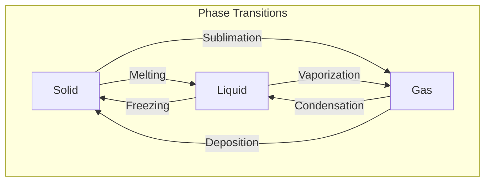

# Chemical Phase Transition

Write a program that determines the type of chemical phase transition based on the initial and final states of matter.

## Task

- Read the initial and final phases of matter from the user as strings
  (case-insensitive; valid phases are `solid`, `liquid`, `gas`)
- Display the transition name (see diagram), or "No transition" if the initial
  and final phases are the same

## Phase Transitions Diagram



## Examples

**Example 1:**

```
liquid
solid
```
```
freezing
```
