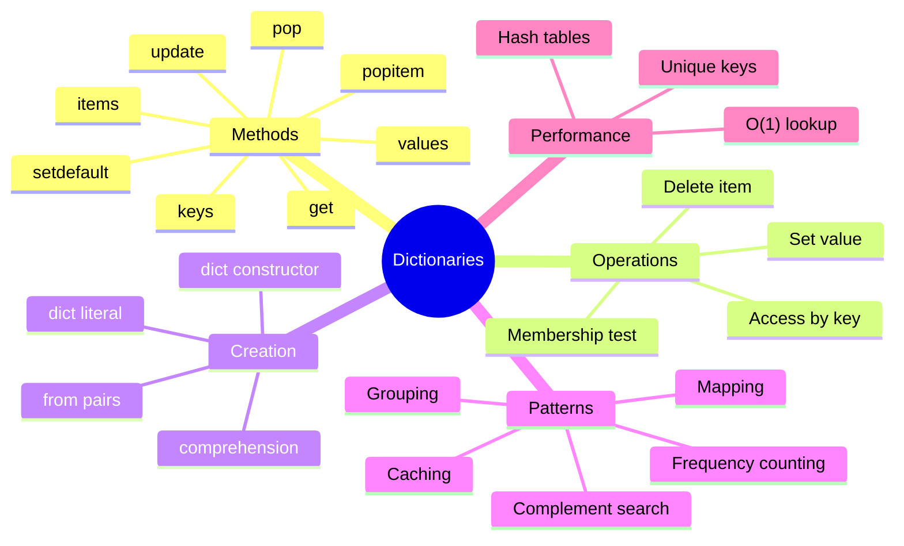

# Table of Contents

## Recommended Reading Order

1. [`dict_basics.md`](dict_basics.md) - Creating dictionaries, basic operations, when to use dictionaries
2. [`dict_operations.md`](dict_operations.md) - Methods, iteration, comprehensions, merging
3. [`dict_best_practices.md`](dict_best_practices.md) - Performance, common patterns, pitfalls

## Practice Questions

### Beginner

1. [`chars_count`](../chars_count/chars_count.md)
2. [`most_frequent_char`](../most_frequent_char/most_frequent_char.md)
3. [`first_unique_char`](../first_unique_char/first_unique_char.md)

### Intermediate

**Encoding & Decoding:**

1. [`read_aloud`](../read_aloud/read_aloud.md)
2. [`morse_encode`](../morse_encode/morse_encode.md)
3. [`morse_decode`](../morse_decode/morse_decode.md)
4. [`roman_to_int`](../roman_to_int/roman_to_int.md)
5. [`text_messaging`](../text_messaging/text_messaging.md)

**Operations:**

1. [`is_anagram`](../is_anagram/is_anagram.md)
2. [`is_phrase_anagram`](../is_phrase_anagram/is_phrase_anagram.md)
3. [`group_anagrams`](../group_anagrams/group_anagrams.md)
4. [`two_sum`](../two_sum/two_sum.md)
5. [`isomorphic_strings`](../isomorphic_strings/isomorphic_strings.md)

### Advanced

1. [`longest_substring_without_repeating`](../longest_substring_without_repeating/longest_substring_without_repeating.md)
