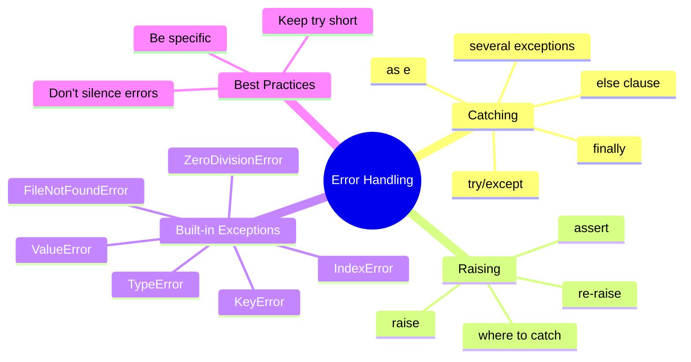

# Table of Contents

## Recommended Reading Order

1. [`error_basics.md`](error_basics.md) - try/except, common exceptions, what not to do
2. [`raising_errors.md`](raising_errors.md) - raise, where to catch, check first or catch
3. [`error_examples.md`](error_examples.md) - Question → Solution format
