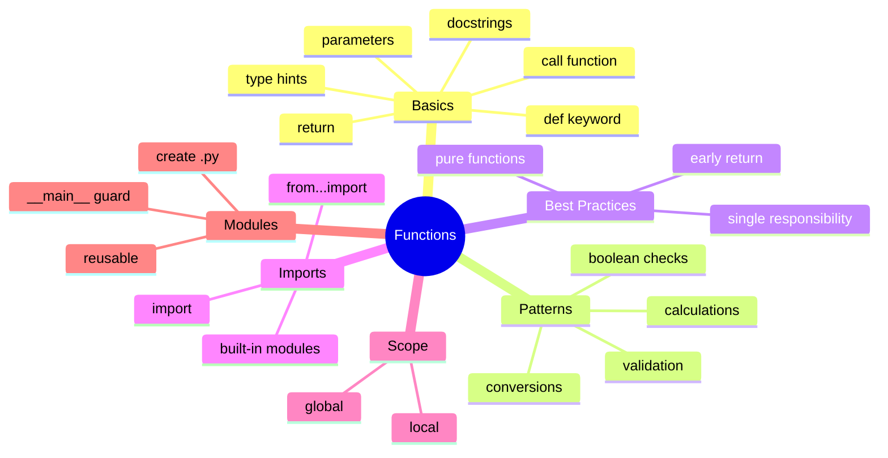

# Table of Contents

## Recommended Reading Order

1. [`function_basics.md`](function_basics.md)
2. [`type_hints_docstrings.md`](type_hints_docstrings.md)
3. [`function_scope.md`](function_scope.md)
4. [`function_patterns.md`](function_patterns.md)
5. [`function_best_practices.md`](function_best_practices.md)
6. [`import.md`](import.md)
7. [`modules.md`](modules.md)

## Practice Questions

1. [`is_even`](../is_even/is_even.md)
2. [`circle_area`](../circle_area/circle_area.md)
3. [`fahrenheit_to_celsius`](../fahrenheit_to_celsius/fahrenheit_to_celsius.md)
4. [`rectangle_area`](../rectangle_area/rectangle_area.md)
5. [`triangle_area`](../triangle_area/triangle_area.md)
6. [`get_hypotenuse`](../get_hypotenuse/get_hypotenuse.md)
7. [`bmi`](../bmi/bmi.md)
8. [`is_leap_year`](../is_leap_year/is_leap_year.md)
9. [`is_triangle`](../is_triangle/is_triangle.md)
10. [`quadratic_roots`](../quadratic_roots/quadratic_roots.md)
11. [`number_of_digits`](../number_of_digits/number_of_digits.md)
12. [`digit_sum`](../digit_sum/digit_sum.md)
13. [`is_palindrome`](../is_palindrome/is_palindrome.md)
14. [`binary_to_decimal`](../binary_to_decimal/binary_to_decimal.md)
15. [`decimal_to_binary`](../decimal_to_binary/decimal_to_binary.md)
16. [`caesar_cipher`](../caesar_cipher/caesar_cipher.md)
17. [`distance_earth`](../distance_earth/distance_earth.md)
18. [`ordinal_to_gregorian`](../ordinal_to_gregorian/ordinal_to_gregorian.md)
19. [`gregorian_to_ordinal`](../gregorian_to_ordinal/gregorian_to_ordinal.md)
20. [`is_int`](../is_int/is_int.md)
21. [`is_prime`](../is_prime/is_prime.md)
22. [`normalize_fraction`](../normalize_fraction/normalize_fraction.md)
23. [`password`](../password/password.md)
24. [`hex_decimal`](../hex_decimal/hex_decimal.md)
25. [`decimal_hex`](../decimal_hex/decimal_hex.md)
26. [`to_base`](../to_base/to_base.md)
27. [`password_strength`](../password_strength/password_strength.md)
