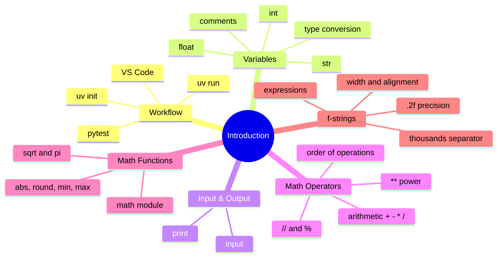

# Table of Contents

## Recommended Reading Order

1. [`first_project.md`](first_project.md)
2. [`working_through_an_exercise.md`](working_through_an_exercise.md)
3. [`vars_and_types.md`](vars_and_types.md)
4. [`math_operators.md`](math_operators.md)
5. [`math_functions.md`](math_functions.md)
6. [`string_formatting.md`](string_formatting.md)
7. [`string_formatting_advanced.md`](string_formatting_advanced.md)

## Practice Questions

1. [`hello_world`](../hello_world/hello_world.md)
2. [`mailing_address`](../mailing_address/mailing_address.md)
3. [`hello_name`](../hello_name/hello_name.md)
4. [`name_age`](../name_age/name_age.md)
5. [`basic_calculator`](../basic_calculator/basic_calculator.md)
6. [`advanced_calculator`](../advanced_calculator/advanced_calculator.md)
7. [`average`](../average/average.md)
8. [`sum_integers`](../sum_integers/sum_integers.md)
9. [`square_area`](../square_area/square_area.md)
10. [`triangle_area`](../triangle_area/triangle_area.md)
11. [`sum_digits`](../sum_digits/sum_digits.md)
12. [`rectangle_perimeter`](../rectangle_perimeter/rectangle_perimeter.md)
13. [`rectangle_area`](../rectangle_area/rectangle_area.md)
14. [`circle_area`](../circle_area/circle_area.md)
15. [`bank_annual`](../bank_annual/bank_annual.md)
16. [`bank_monthly`](../bank_monthly/bank_monthly.md)
17. [`triangle_heron`](../triangle_heron/triangle_heron.md)
18. [`temperature`](../temperature/temperature.md)
19. [`celsius_convert`](../celsius_convert/celsius_convert.md)
20. [`distance_conversion`](../distance_conversion/distance_conversion.md)
21. [`shopping`](../shopping/shopping.md)
22. [`tip_calculator`](../tip_calculator/tip_calculator.md)
23. [`bmi`](../bmi/bmi.md)
24. [`time_seconds`](../time_seconds/time_seconds.md)
25. [`time_hours`](../time_hours/time_hours.md)
26. [`time_units`](../time_units/time_units.md)
27. [`time_reverse`](../time_reverse/time_reverse.md)
28. [`sort_integers`](../sort_integers/sort_integers.md)
29. [`pressure_units`](../pressure_units/pressure_units.md)
30. [`regular_polygon`](../regular_polygon/regular_polygon.md)
31. [`free_fall`](../free_fall/free_fall.md)
32. [`sphere_volume`](../sphere_volume/sphere_volume.md)
33. [`heat_capacity`](../heat_capacity/heat_capacity.md)
34. [`ideal_gas`](../ideal_gas/ideal_gas.md)
35. [`distance_earth`](../distance_earth/distance_earth.md)
