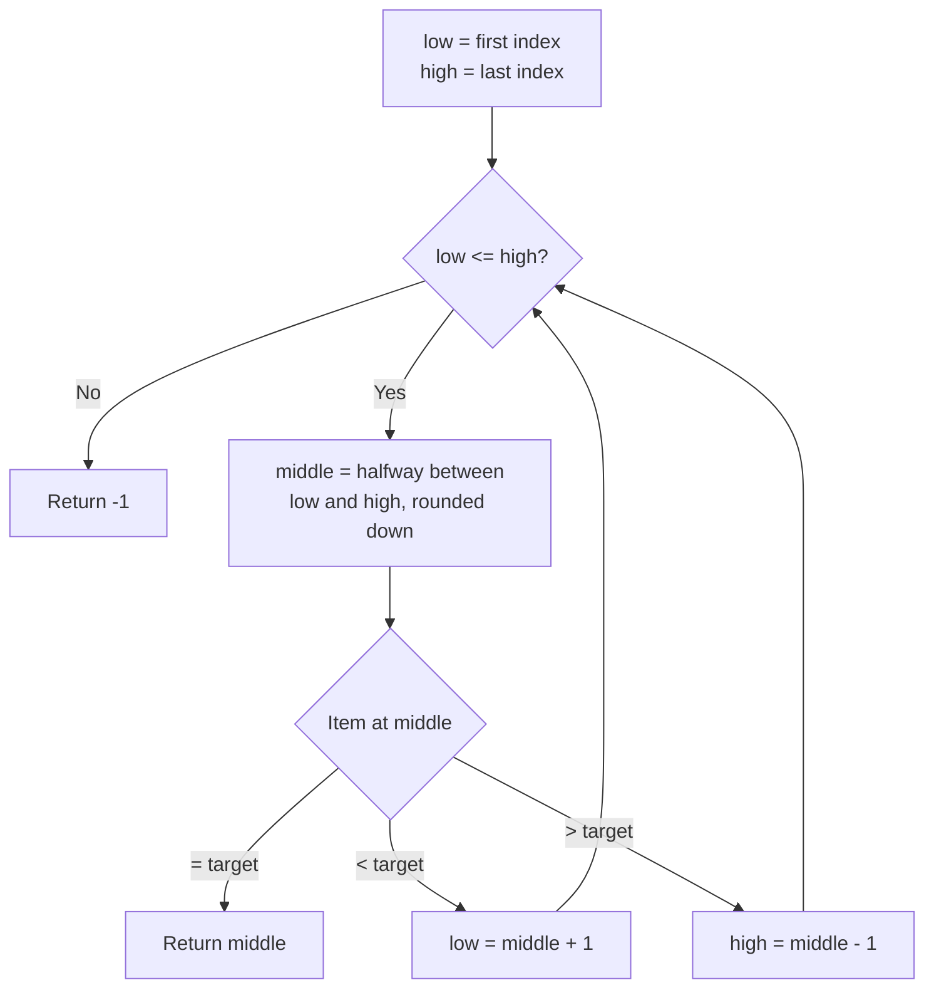

# Binary Search - Hint

## Algorithm

- Keep two boundaries, `low` and `high`, that bracket where the target can still be
- Look at the middle element between them
- If it's the target, you're done; if it's too small, the target must be in the right half; if too big, the left half
- Move the matching boundary past the middle and repeat until the boundaries cross

## Note

Each comparison halves the remaining range, so the search takes O(log n) steps instead of scanning every element.
