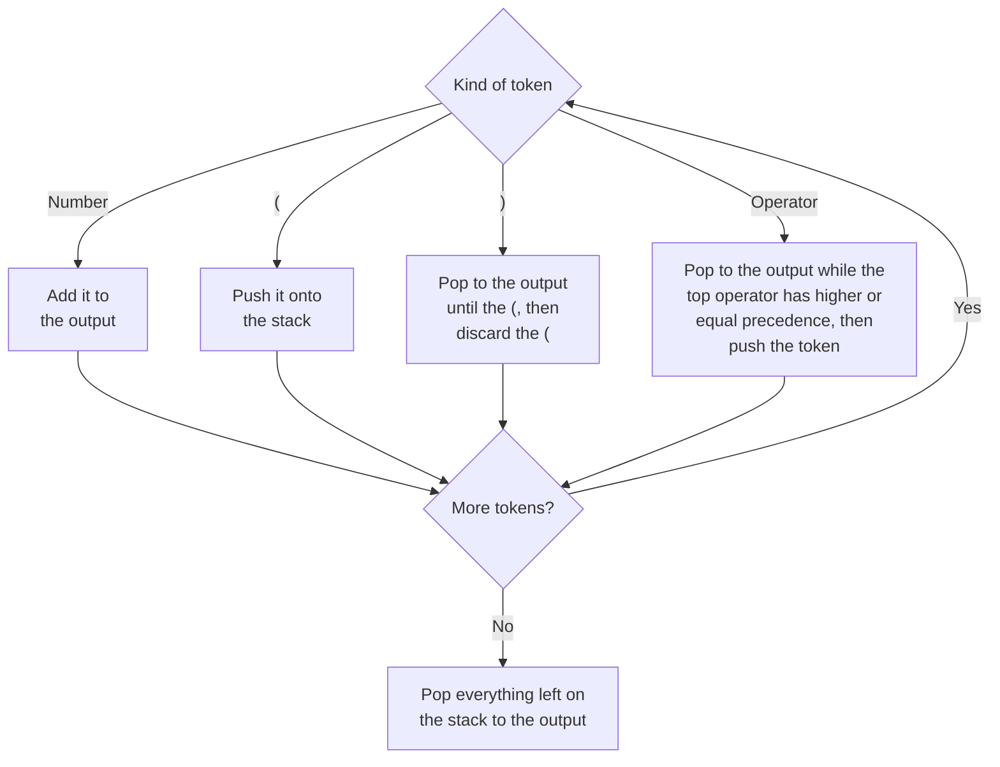

# Infix to Postfix - Hint

## Algorithm

- Keep an output list and an operator stack
- Numbers go straight to the output
- `(` is pushed onto the stack; `)` pops operators to the output until the matching `(`
- Before pushing an operator, first pop operators of higher or equal precedence to the output
- After the last token, pop whatever remains on the stack to the output

## Note

This is Dijkstra's Shunting Yard algorithm — the stack holds back operators until their operands have reached the output.
