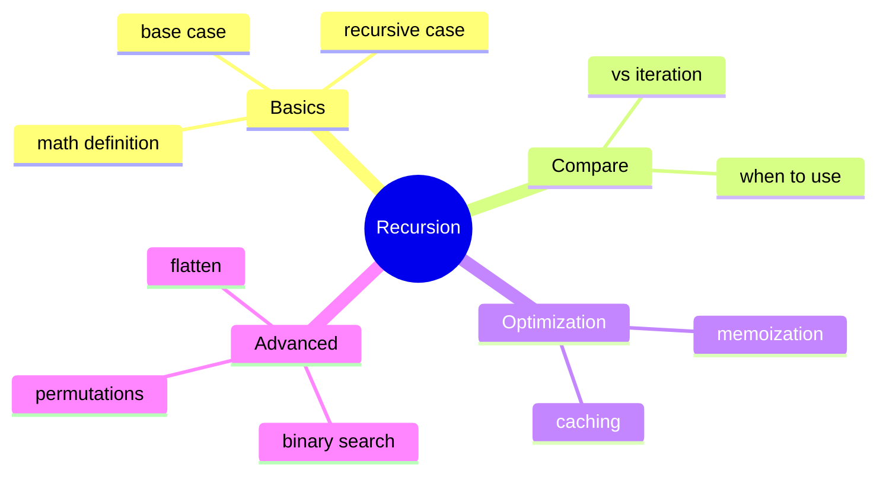

# Table of Contents

## Recommended Reading Order

1. [`what_is_recursion.md`](what_is_recursion.md) - Math definition, first code
2. [`base_case.md`](base_case.md) - Stopping condition
3. [`examples.md`](examples.md) - Question → Solution format
4. [`recursion_vs_iteration.md`](recursion_vs_iteration.md) - Comparison
5. [`memoization.md`](memoization.md) - Caching results
6. [`advanced.md`](advanced.md) - Binary search, flatten, permutations

## Practice Questions

### Beginner

1. [`factorial`](../factorial/factorial.md) - Calculate n!
2. [`sum_to_n`](../sum_to_n/sum_to_n.md) - Sum from 1 to n
3. [`count_digits`](../count_digits/count_digits.md) - Count digits in number
4. [`sum_digits`](../sum_digits/sum_digits.md) - Sum digits of number

### Intermediate

1. [`power`](../power/power.md) - Calculate base^exponent
2. [`fibonacci`](../fibonacci/fibonacci.md) - Nth Fibonacci number
3. [`gcd`](../gcd/gcd.md) - Greatest common divisor

### Advanced

1. [`binary_search`](../binary_search/binary_search.md) - Search in sorted list
2. [`flatten_list`](../flatten_list/flatten_list.md) - Flatten nested lists
3. [`nested_sum`](../nested_sum/nested_sum.md) - Sum of nested list
4. [`edit_distance`](../edit_distance/edit_distance.md) - String edit distance (Levenshtein)
5. [`coin_sum`](../coin_sum/coin_sum.md) - Count ways to make change
6. [`element_spelling`](../element_spelling/element_spelling.md) - Spell words with element symbols
7. [`element_sequences`](../element_sequences/element_sequences.md) - Longest element chain game
8. [`run_length_encoding`](../run_length_encoding/run_length_encoding.md) - Compress strings
9. [`run_length_decoding`](../run_length_decoding/run_length_decoding.md) - Decompress strings
