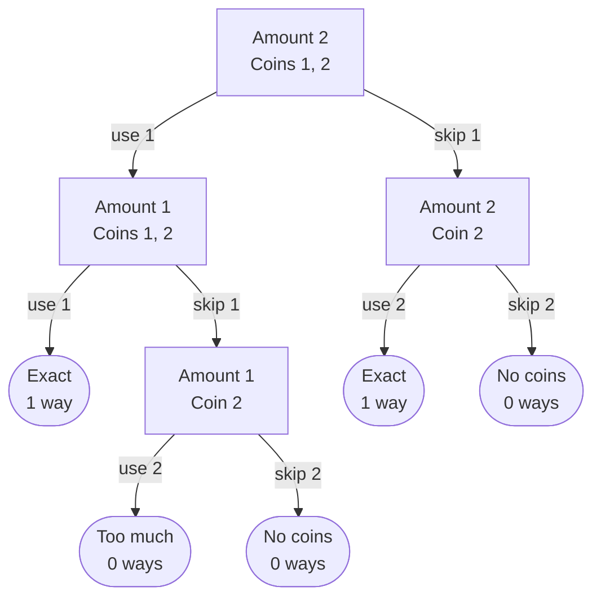

# Coin Sum - Hint

## Algorithm

- Recurse on two things at once: the remaining amount and the coins still allowed
- At each step, either use the first coin (subtract it from the amount, keeping the coin available for reuse) or skip it (drop it and move to the next coin) - add the counts of both branches
- Reaching exactly 0 counts as one way; going negative or running out of coins counts as zero

Here is `coin_sum(2, [1, 2])`. Each box shows the remaining amount and the coins
still allowed. Each rounded box ends a branch, and together they add up to 2 ways:
`1 + 1` and `2`.

## Note

Deciding per coin (use it or drop it) counts each combination once - recursing only on the amount would count 2+1 and 1+2 as different ways.
