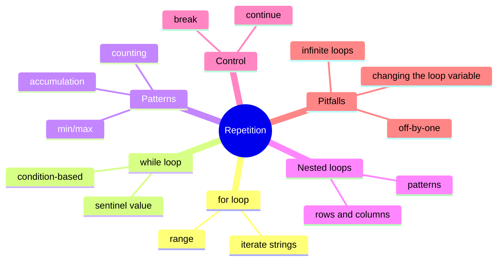

# Table of Contents

## Recommended Reading Order

1. [`for_loop.md`](for_loop.md)
2. [`while_loop.md`](while_loop.md)
3. [`loop_patterns.md`](loop_patterns.md)
4. [`nested_loops.md`](nested_loops.md)
5. [`loop_control.md`](loop_control.md)
6. [`random_numbers.md`](random_numbers.md)
7. [`loop_best_practices.md`](loop_best_practices.md)

## Practice Questions

1. [`first_n_numbers`](../first_n_numbers/first_n_numbers.md)
2. [`countdown`](../countdown/countdown.md)
3. [`even_numbers`](../even_numbers/even_numbers.md)
4. [`odd_numbers`](../odd_numbers/odd_numbers.md)
5. [`sum_to_n`](../sum_to_n/sum_to_n.md)
6. [`factorial`](../factorial/factorial.md)
7. [`arithmetic_sequence`](../arithmetic_sequence/arithmetic_sequence.md)
8. [`geometric_sequence`](../geometric_sequence/geometric_sequence.md)
9. [`fizz_buzz`](../fizz_buzz/fizz_buzz.md)
10. [`digit_sum`](../digit_sum/digit_sum.md)
11. [`number_of_digits`](../number_of_digits/number_of_digits.md)
12. [`multiplication_table`](../multiplication_table/multiplication_table.md)
13. [`number_triangle`](../number_triangle/number_triangle.md)
14. [`number_pyramid`](../number_pyramid/number_pyramid.md)
15. [`average`](../average/average.md)
16. [`admission_price`](../admission_price/admission_price.md)
17. [`vanilla_min_max`](../vanilla_min_max/vanilla_min_max.md)
18. [`max_streak`](../max_streak/max_streak.md)
19. [`no_pennies`](../no_pennies/no_pennies.md)
20. [`collatz`](../collatz/collatz.md)
21. [`gcd`](../gcd/gcd.md)
22. [`binary_to_decimal`](../binary_to_decimal/binary_to_decimal.md)
23. [`decimal_to_binary`](../decimal_to_binary/decimal_to_binary.md)
24. [`palindrome`](../palindrome/palindrome.md)
25. [`multiword_palindrome`](../multiword_palindrome/multiword_palindrome.md)
26. [`parity_bits`](../parity_bits/parity_bits.md)
27. [`password_strength`](../password_strength/password_strength.md)
28. [`caesar_cipher`](../caesar_cipher/caesar_cipher.md)
29. [`guess_number`](../guess_number/guess_number.md)
30. [`maximum_integer`](../maximum_integer/maximum_integer.md)
31. [`coin_flip`](../coin_flip/coin_flip.md)
32. [`polygon_perimeter`](../polygon_perimeter/polygon_perimeter.md)
33. [`square_root`](../square_root/square_root.md)
34. [`approximate_pi`](../approximate_pi/approximate_pi.md)
35. [`prime_factors`](../prime_factors/prime_factors.md)
