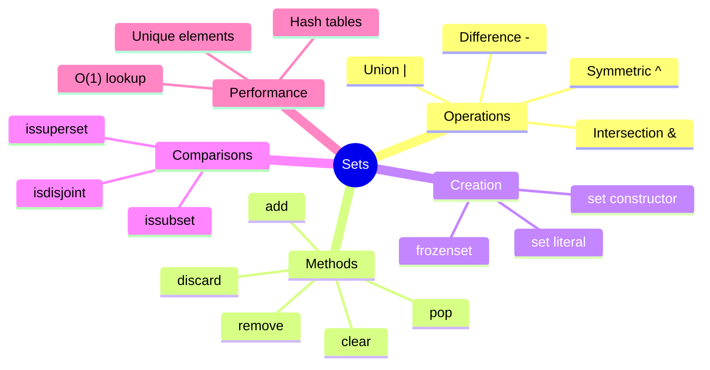

# Table of Contents

## Recommended Reading Order

1. [`set_basics.md`](set_basics.md) - Creating sets, basic operations, when to use sets
2. [`set_operations.md`](set_operations.md) - Union, intersection, difference, symmetric difference
3. [`set_best_practices.md`](set_best_practices.md) - Performance, common patterns, pitfalls

## Practice Questions

### Beginner

1. [`set_operations`](../set_operations/set_operations.md)

### Intermediate

1. [`remove_duplicate_letters`](../remove_duplicate_letters/remove_duplicate_letters.md)
1. [`find_missing_numbers`](../find_missing_numbers/find_missing_numbers.md)
1. [`pangram_checker`](../pangram_checker/pangram_checker.md)
1. [`isogram`](../isogram/isogram.md)

### Advanced

1. [`longest_consecutive`](../longest_consecutive/longest_consecutive.md)
