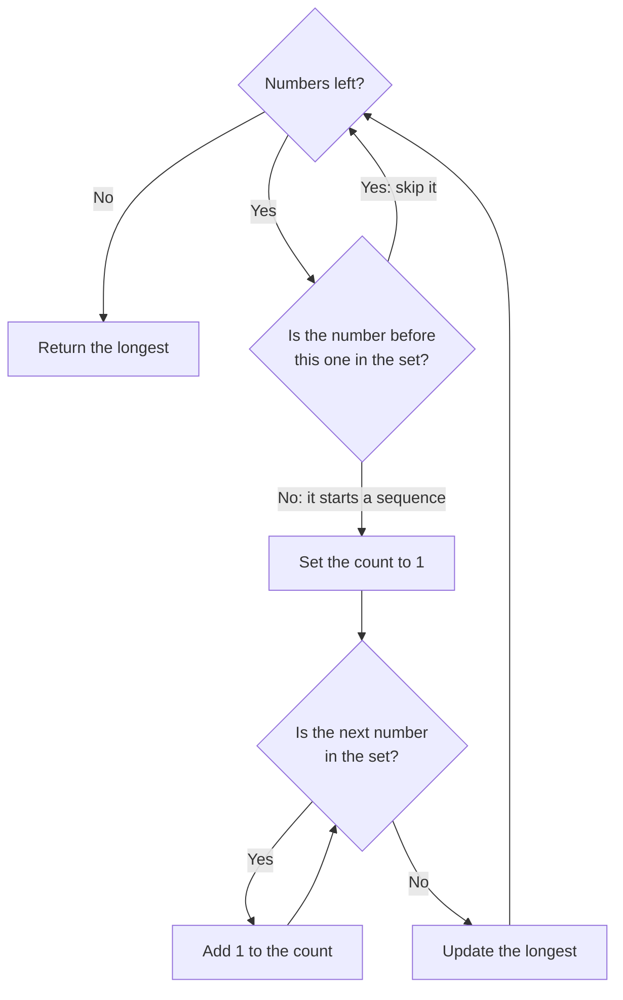

# Longest Consecutive Sequence - Hint

## Algorithm

- Put all numbers into a set for O(1) membership checks
- A number starts a sequence only if `num - 1` is not in the set — skip all other numbers
- From each sequence start, count upward (`num + 1`, `num + 2`, …) while the next number is in the set
- Track the longest count seen

## Note

Counting only from sequence starts visits each number at most twice, making the algorithm O(n) instead of O(n²).
